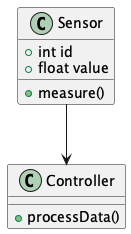
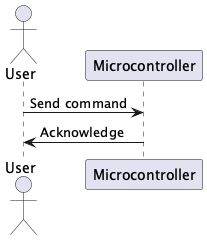
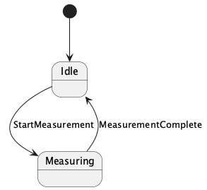
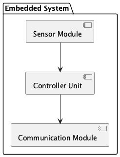
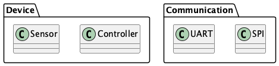
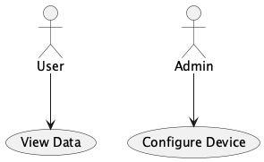
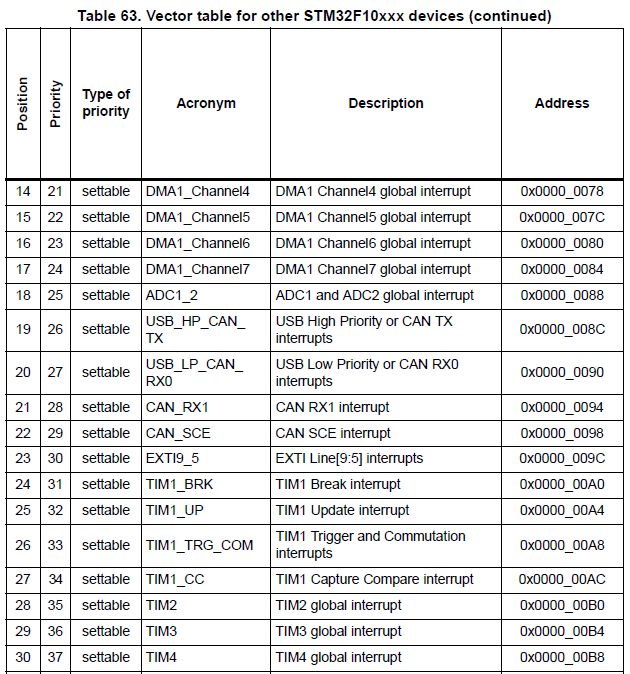

[.text-center]
== Отчет по программному обеспечению измерительных процессов 


:toc:
:numbered:
:sectnums:
:source-highlighter: coderay
:icons: font
                             
[.text-center]
Федеральное государственное автономное образовательное  
учреждение высшего образования  
«Южно-Уральский государственный университет  
(национальный исследовательский университет)»  

[.text-center]
Высшая школа электроники и компьютерных наук
[.text-center]
Кафедра «Информационно-измерительная техника»

[.text-center]
ЮУрГУ  

[.text-right]
Автор работы,  
[.text-right]
студент группы ЕТ-211 
[.text-right]
Нигматзянов К.М.  
[.text-right]
Проверил:
[.text-right]
Колодий С.В. 

[.text-right]
2025г.

[.text-center]
Челябинск 2025

== Цель отчета 

Основная цель данного отчета - *понять и объяснить принципы работы системы прерываний в микроконтроллерах*, включая:
====
* Механизм обработки прерываний и их виды
* Назначение и работу контроллера прерываний NVIC
* Структуру и назначение таблицы векторов прерываний
* Правила написания обработчиков прерываний
* Практический пример обработки прерывания от таймера
====
Особое внимание уделено *практической реализации* обработки прерываний на примере таймера TIM2 в микроконтроллерах 


== Как работают прерывания

=== Что такое прерывание?
Прерывание — это экстренное событие, которое заставляет процессор:
====
*  Немедленно остановить текущую программу
*  Выполнить специальную функцию (обработчик)
*  Вернуться обратно к прерванной программе
====

=== Какие бывают прерывания?
====
 * Аппаратные — от периферии (таймеры, UART, GPIO)
 * Программные — вызванные специальной командой
 * Исключения — ошибки (деление на 0, доступ к запрещенной памяти)
====

=== Что происходит при прерывании?
====
*  Процессор запоминает текущее место в программе
*  Переходит к выполнению обработчика прерывания
*  После выполнения — возвращается обратно
====

== PlantUML

PlantUML — это инструмент для создания диаграмм с помощью простого текстового описания, без использования графического интерфейса.
 
=== Что может делать PlantUML:

* Диаграмма классов



* Диаграмма последовательности



* Диаграмма состояний



* Диаграмма компонентов



* Диаграмма пакетов



* Диаграмма прецедентов



== Принципы SOLID

=== Принцип единственной ответственности (SRP)

* Каждый класс должен отвечать только за одну операцию.

=== Принцип инверсии зависимостей (DIP)

* Модули верхнего уровня не должны зависеть от модулей нижнего уровня. И те, и другие должны зависеть от абстракций. Абстракции не должны зависеть от деталей. Детали должны зависеть от абстракций.


==  Контроллер прерываний NVIC

=== Что такое NVIC?
Nested Vectored Interrupt Controller — это "диспетчер прерываний" в ARM-микроконтроллерах.

=== Основные функции:
====
• Определяет какое прерывание выполнить первым
• Разрешает/запрещает отдельные прерывания
• Устанавливает приоритеты (какие прерывания важнее)
====
=== Пример настройки:
```c
NVIC_EnableIRQ(TIM2_IRQn);  // Разрешаем прерывание от таймера 2
NVIC_SetPriority(TIM2_IRQn, 2); // Устанавливаем приоритет
```

==  Таблица векторов прерываний

=== Что это?
Это "адресная книга" процессора, где записано:
====
• Какие прерывания существуют
• Где находятся их обработчики
====
=== Как выглядит?



==  Обработчики прерываний

=== Как правильно писать обработчик?
====
* Должен быть коротким (не делать сложных вычислений)

* Обязательно очищать флаг прерывания

* Использовать volatile для общих переменных
====
=== Пример:

```c
volatile uint32_t ticks = 0;

void TIM2_IRQHandler(void) {
    if (TIM2->SR & TIM_SR_UIF) { // Проверяем флаг
        ticks++;                 // Увеличиваем счетчик
        TIM2->SR &= ~TIM_SR_UIF; // Сбрасываем флаг!
    }
}
```

== Обработка переполнения таймера 2

=== Последовательность действий:

Настраиваем таймер:

```c
RCC->APB1ENR |= RCC_APB1ENR_TIM2EN; // Включаем тактирование
TIM2->PSC = 7999;                   // Предделитель
TIM2->ARR = 999;                    // Автоперезагрузка
TIM2->DIER |= TIM_DIER_UIE;         // Разрешаем прерывание
TIM2->CR1 |= TIM_CR1_CEN;           // Запускаем таймер
```

Разрешаем прерывание в NVIC:

```c
NVIC_EnableIRQ(TIM2_IRQn);
```

Пишем обработчик:

```c
volatile uint32_t ticks = 0;

void TIM2_IRQHandler(void) {
    if (TIM2->SR & TIM_SR_UIF) { // Проверяем флаг
        ticks++;                 // Увеличиваем счетчик
        TIM2->SR &= ~TIM_SR_UIF; // Сбрасываем флаг!
    }
}
```

=== Что происходит внутри МК:
====
* Таймер считает до 999 → переполняется

* Устанавливается флаг UIF (Update Interrupt Flag)

* Процессор прерывает основную программу

* Выполняет TIM2_IRQHandler()

* Возвращается к месту прерывания
====

== Общие выводы
====
1. *Прерывания - критически важный механизм*:
   - Позволяют реагировать на события в реальном времени
   - Экономят ресурсы процессора (не нужно опрашивать флаги в цикле)
   - Обеспечивают приоритетную обработку важных событий

2. *NVIC - интеллектуальный диспетчер*:
   - Позволяет гибко управлять приоритетами
   - Обеспечивает обработку вложенных прерываний
   - Упрощает разработку сложных систем

3. *Таблица векторов - фундамент системы*:
   - Связывает события с обработчиками
   - Требует аккуратного конфигурирования
   - Размещается в строго определенной области памяти

4. *Обработчики требуют дисциплины*:
   - Должны быть максимально короткими
   - Обязаны очищать флаги прерываний
   - Для общих данных используется volatile

5. *Пример с таймером показывает*:
   - Типичную последовательность настройки
   - Важность своевременного сброса флагов
   - Как организовать периодические события
====

*Практическое применение*:

- Создавать более эффективные программы для МК

- Реагировать на события в реальном времени

- Оптимизировать использование ресурсов процессора
